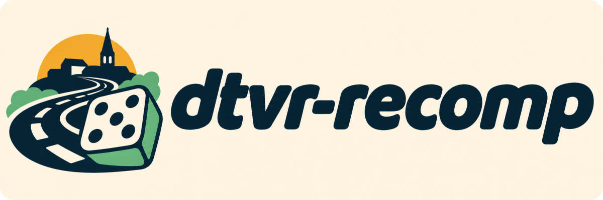

# DTVR Recomp

<picture>
  <source media="(prefers-color-scheme: dark)" srcset="assets/branding/banner-dark.svg">
  
</picture>

Native Linux reconstruction of **Die total verrückte Rallye** (Blue Byte; US English
retail edition: *Dr. Drago's Madcap Chase*).
Current project version: **0.0.1** ([release and AppImage policy](docs/releases.md)).
The game window (`--game`) is playable: title, player setup, the rally with its
recovered rules, computer opponents, cards, towns, events and the original
scenes, with all art, text and sounds loaded from your own installation. It is
a manual reconstruction in C++17 / SDL2, not a translation of the original
executable, and still incomplete; see the status table.

## Project status

Current milestone: **the original game window, complete and faithful**: every
window and its input traced from rally.exe, then remaining rule details.
Status applies to the supported input version; no overall completion percentage
is claimed.

| Component | Status | Implemented / next step | Source or details |
| --- | --- | --- | --- |
| Source-only distribution | ✅ Implemented | User supplies an ISO or complete original game directory; external installation, generic example paths and source policy checks. | [Policy](docs/distribution.md) |
| Original-data installer and Linux build | ✅ Implemented | GUI selection of ISO or directory, preflight, directory input SHA-256 inventory, automatic compilation/tests, Ogg preparation, progress/cancel and game-window launch. Explicit local updates preserve user files and a complete backup. | [GUI](tools/installer_gui.py), [pipeline](docs/installer.md) |
| US English edition | ✅ Implemented | The US English retail CD ("Dr. Drago's Madcap Chase", `RALLY.EXE` `a8374ca9…`) is installable and playable with its own data: edition profiles in the runtime ([edition](src/edition.cpp)) and the installer ([editions](tools/editions.py)) identify it by the SHA-256 of `rally.exe` or of the installation manifest, check its files and the `dat/lan.inf` letter, and select overview, canvases, the retail empty-slot label, credits path and 640 setup name fields. Its rules are the German ones (retail audit); one complete human turn gave the same simulation log as the German data. Saves record the edition, live in a directory per edition and refuse the other one; both editions read `europe.map` afresh for every new or loaded game (retail behaviour). Music: the pinned release Ogg tracks (not original) or MIDI. Blue Byte's official English demo (`c8b7dab6…`, Demo Version 27-MAY-95) is recognised and refused as unsupported. | [Edition profiles](docs/media-variants.md#edition-profiles), [installer](docs/installer.md), [saves](docs/save-format.md#editions) |
| Versioned setup AppImage | 🟡 Packaging implemented | Bundled Python/Tk and committed installer source; host build/audio dependencies are checked. Public releases and other-platform validation remain pending. | [Packaging and versions](docs/releases.md) |
| Original executable analysis | ✅ Tools available | NE headers, imports and disassembly tools; generated code stays private and external. | [Tools](tools/ne_disasm.py), [findings](docs/formats.md) |
| Native executable translation | ⬜ Not implemented | The game is a manual C++ reconstruction; original instructions are not translated. | [Architecture](docs/architecture.md) |
| Sprite data | 🟡 Partial | SBS frames decoded; colour key 0 confirmed from the blitter, callers of seg2:9497 pass their own key (e.g. 0xFF for the statistics arrows). Animation records and their exact step rule (seg2:6DCB) drive the finish, victory and all event scenes. Vehicle frames placed as the original sprite list (seg2:3EB0). | [SBS parser](src/sbs.cpp), [event scenes](src/event_scenes.cpp) |
| World map and seasons | 🟡 Partial | Full tile map, layers, mirroring and seasonal tile selection; the map origin is centred, clamped and edge-scrolled as in rally.exe, with zoom; the water cycles its palette as the original. | [World map](src/worldmap.cpp), [scrolling](src/map_scroll.cpp) |
| Board and towns | 🟡 Partial | 700 fields, links, field lists and 115 towns with their property entries decoded (graph overlay in the viewer); the field actions are rebuilt (see turn logic). Open: the town entry fields +0x1E (category, value 3 tested separately) and +0x20, `flagset` bits 0–4 and `europe.car`. | [Board parser](src/board.cpp) |
| Viewer input and display | ✅ Viewer implemented | Mouse zoom/pan, keyboard navigation and inspection views; a debugging aid next to the game window (`--game`). | [SDL viewer](src/main.cpp) |
| Original game window | 🟡 Partial | `--game` (optionally `--resolution 640/800/1024`, F11 fullscreen): title, player setup, options, save / load dialog, menus of the language file, the canvas with map, portrait, info panel and slot machine, all at the original positions with art and text loaded from the installation. The message window shows the language texts with the showmaster, Dr. Drago, card, professor or club pictures and Yes / No questions (obstacle card, quit). Card window with SBBUTTON focus, press and GESPERRT overlay; target choice, Flugzeug booking, Nägel direction, investment offer, Risiko, card shop, town dialog ESTATES, statistics, overview, Umfeld and zoom; stage announcement, year balance, monthly statement, finish and victory sequences; every event plays its original animation at its place. Card films (FLC) play natively; vehicles become planes on sea routes. Blue Byte logo while loading, intro (skipping it opens the title at once), sights, subtitles, ambient map animations, the stage count window (with a slider as a recomp addition) and the forced sale. On the map only the main window's keys of seg4:0259 (plus the recomp keys) act, no viewer shortcuts; Return there is seg2:0BC3. Open: remaining presentation and timing details. Not rebuilt by decision (user, 2026-11-26): the joystick calibration dialog (key C, seg2:7F72); modern controllers need none. | [Game window](src/game_screen.cpp), [flow](src/game_window.cpp), [layout](src/layout.cpp), [evidence](docs/formats.md#game-window-round-21) |
| CD audio import | 🟡 Partial | Six provisional Ogg segments exported and verified; original track boundaries/IDs remain unverified. | [Audio importer](tools/cd_audio.py), [evidence](docs/cd-audio.md) |
| Native music, speech and effects | 🟡 Partial | Ogg streaming shares the stereo effects mixer; startup, game, destination, winner, Drago and recovered event cues. Sound set and master volume on the Audio page of the recomp menu (F8); mixing as rally.exe (voices silence the effects); remaining original transition boundaries and listening validation are open. | [Native music](docs/native-music.md), [effects](src/sound.cpp) |
| Complete Ogg sound sets | ✅ Preparation and selection implemented | Render all 25 cues using supplied banks; classic/dry styles, catalog validation, native discovery and selection in the recomp menu (F8). | [Soundtrack builder](docs/soundtracks.md) |
| Movement rules | 🟡 Partial | Slot machine roll, field step counting with undo, original random generator, tile properties (`europe.pit`) and routes recovered and tested; move preview in the world view; arrow-key driving and the original mouse steering cross (MCTRL) and game controllers as the original joystick, with the step and arrival rules. | [Rules](src/rules.cpp), [evidence](docs/formats.md#movement-round-4) |
| Turn logic and original rules | 🟡 Partial | Playable rally in the game window and the terminal hotseat mode (`--play`): London start, slot roll, field movement with undo, money fields, inflation, player change, months, random destinations, stages, the Master-Rallye (all drivers moved to the start cells, Dr. Drago to the leader, final destination Brussels) and game end — all from recovered rules. Event card deck with yellow-field draws; 37 of 41 card types playable (movement, Fiskus, Konto, Schulden, Zero, Zucker, Schlafen, Blockieren, Weihnachten, Hau ab, Erdbeben, Nägel, Punch, Konferenz, Flugzeug, Verdoppeln, Tschüss, Steuerlos, Risiko and the eight property cards in the town dialog) plus four passive protection cards; Dr. Drago rides along with all six of his actions and follows on the map in his own vehicle (bicycle / boat, rocket car, blimp), leaving and returning at a form change and driving to the new holder at Hau ab; properties can be bought and sold in towns (starting cash 30,000, monthly income, whole-town bonus, credit charged at the year end); random events are triggered and Eastern Europe stays behind border barriers until enough property is owned; robbers, road obstacles (cleared with Schneepflug) and property damage (protected by Versicherung / Nessie) work; the professor and football club offer investments that return double or nothing. Computer players drive, buy, play and trade cards with the original strategy tables, Steuerlos hands a turn to them, and a single human gets a computer opponent as in the original. Nebel is unused in the original executable. Card fields work as a card shop (buy at the card value, sell for half; used cards return to the deck). Not modelled: the Steuerlos swap of DS:10 and the computer's 1 s wait before its Return. | [Game](src/game.cpp), [Dr. Drago](src/drago.cpp), [events](src/events.cpp), [obstacles](src/obstacles.cpp), [cards](src/cards.cpp), [economy](src/economy.cpp), [evidence](docs/formats.md#risiko-nebel-and-the-player-setup-round-19) |
| AI, saves and hotseat | 🟡 Partial | Hotseat for 1–8 players; computer players with the original strategy tables (driving, buying, cards, card field); versioned native save format with exact round trip and atomic writes, the original save dialog with slots and an autosave at each turn; saving from MAIN1, loading from the title menu, one save directory per edition, and loading recomputes what rally.exe's loader does (seg8:AC9A). Driver names come from the language file at run time. A computer plans its route after the slot window, and its investment offer is declined by the window's timeout as in rally.exe. | [AI](src/ai.cpp), [saves](docs/save-format.md), [save slots](src/save_slots.cpp) |
| LAN / Internet multiplayer | ⬜ Planned | Starts after the port is complete (user decision 2026-11-26). Plan: host authority, lobby, host code over a small WebSocket relay, the same protocol for LAN / direct IP, reconnection. | [Multiplayer](docs/architecture.md#multiplayer) |
| Modern controls and usability | 🟡 Partial | Game controllers as the original joystick (every window and dialog reachable by pad) plus recomp pad buttons (Start, View, X, Y, LB/RB, right stick; [pad layer](src/pad_input.cpp)), every pad button remappable on the Steuerung page ([pad map](src/pad_map.cpp)), an on-screen keyboard for names ([OSK](src/osk.cpp)), mouse wheel where the original has page arrows, recomp menu (Escape / F8), F12 text smoothing. Planned: contextual help, route planning and event history. | [Backlog](docs/architecture.md#feature-backlog) |
| Optional graphics | 🟡 Partial | Window / fullscreen with whole-number pixel scaling and black borders (F11, `[Display]`); optional widescreen with a wider map window (`--widescreen`, `[Display] Widescreen`, [layout](src/layout.cpp)); text smoothing F12 / `[Display] TextSmoothing`: 0 Original (no anti-aliasing), 1 at canvas size, 2 at screen resolution while scaled. Shaders, smoothing filters and parallax are planned. | [Graphics](docs/architecture.md#optional-graphics) |
| Automated validation | ✅ Implemented | Synthetic parser/installer tests and repository policy workflow; local ISO integration checks. | [Tests](tests), [CI](.github/workflows/source-policy.yml) |

<details>
<summary>Reconstruction steps so far (evidence with addresses in <a href="docs/formats.md">docs/formats.md</a>; list numbers are not the "round N" numbers used there; later steps name their pull requests)</summary>

1. SBS sprite container decoded (all 94 files, 1,559 frames).
2. World map composed with the original loader and draw rules; transparency confirmed.
3. Board decoded: field graph from `europe.str`, towns, field lists.
4. Movement: slot machine, step counter, `europe.pit` tile flags, rand(), routes.
5. Turn: arrow-key input, arrival only after the full allowance, field kinds
   (blue money, red cost, yellow event card, towns, card field), inflation.
6. Players, months, destinations and stages; first playable hotseat rally (`--play`).
7. Event cards: 41 types, 199-card deck with original shuffle, hands, yellow field,
   movement cards (2–5 Walzen, 1 oder 2, 1–6 Felder).
8. Properties: town state, purchases (normal, discount, rent, take, buy-out,
   credit), whole-town bonus and monthly income; starting cash 30,000.
9. Selling, credit at the year end, card targets, money and status cards
   (Fiskus, Konto, Schulden, Zero, Zucker, Schlafen, Blockieren).
10. Dr. Drago: placement at each stage, form changes, passing on meetings, six
    actions; cards Weihnachten and Hau ab.
11. Events: trigger and countdown, four progress-dependent event tables, Eastern
    Europe behind 15 border barriers until the players own enough property;
    robbers.
12. Event effects: rain, snow and rockfall block roads for 3–4 rounds (Schneepflug
    clears them); storm, drought, flood, Nessie, earthquake and volcano destroy
    uninsured properties in a town (Versicherung, Nessie protect).
13. Professor and football club investments; cards Erdbeben, Nägel, Punch,
    Konferenz, Flugzeug and Verdoppeln; play view split from the viewer.
14. Property cards 1–8 in the town dialog, Tschüss; Steuerlos and Risiko traced.
15. Card fields as card shop; used cards return to the deck.
16. Computer players: route planning, end-field scores, town purchases, Steuerlos.
17. Computer card play: card choice and targets, card field, discarding.
18. Native versioned save format (`src/save.cpp`, [format](docs/save-format.md)).
19. Risiko, Nebel (unused in the original) and the single-player opponent.
20. Player slots as in `[Player]` P0–P7, games of computers until stopped,
    driver names from the language file.
21. Game window frame as in the original (`--game`): canvas, map window,
    portrait and player info panel at the original positions for 640/800/1024.
22. Player info panel contents (month, cash, destination, digits, field kind) with
    Arial/Liberation Sans text and the original digit sprites.
23. Slot machine over the map with spinning and stopping reels and the sum
    display at the original positions; animation format decoded.
24. Vehicles of the drivers on the map with their facing and driving animation.
25. Original message window with language texts for the solo opponent, the
    yellow field and the events; East opening random draw corrected.
26. Messages of Dr. Drago, sit-outs, blocked cards, Christmas and investments;
    two missing random draws corrected.
27. Card messages (Fiskus, Konto, Schulden, Zero, Konferenz, n Felder, Erdbeben).
28. Menu window with the original menus ONFIELD, RIGHTBTN and MAIN1 (RT_MENU reader).
29. Card window with the original card pictures and layout.
30. Town dialog ESTATES: property list with owner, price, income and yield; buying
    and selling by mouse.
31. Smooth driving at the original speed with held arrow keys; scrolling rule of
    the town dialog.
32. Computer turns drive field by field on the map (same draws as before).
33. Save dialog as in the original (nine slots, native save files in the user's data
    directory); rules revision 26.
34. Statistik (the statistics variant of the town dialog) and `--load <slot>`.
35. Title menu MAIN with the original title picture: new game, load, continue from
    the autosave of each turn start.
36. Player setup PLAYER: drivers as free / human / computer, names, start.
37. Übersicht (overview map with route and flags) and Umfeld (looking around).
38. Zoom (Zoom entries, Insert / Delete): half the world area at twice the size.
39. Options window with the original switches; settings stored in the user's
    configuration (Views applied to the map).
40. Sound effects from snd/fx through SDL audio (menus, slot machine, money fields,
    sit-outs, blocked cards).
41. Driving sounds, Dr. Drago's laugh, pause keys 1–4 with their voice memos, Credits.
42. Demo from the title: four computer drivers as in the original; Escape or a
    right click return to the title.
43. Stage end as in the original: the missing random draws and the result texts
    (save format 4, rules revision 27).
44. Year balance: its fixed random draws (rules revision 28); timing-dependent draws
    of the original cannot be reproduced.
45. Finish sequence ZIEL at each destination: town photo, banner, band, crowd and the
    driver's car with the original animations and sound.
46. Victory sequence SIEG after the Master-Rallye: podium with the three best drivers
    by cash and property value, crowd, band and speaker.
47. Year balance show BILANZ: the show master pulls the lever for every driver and
    announces the result (positive or negative year) with the original voices.
48. The game window's flow moved to its own module (src/game_window.cpp).
49. Destination announcement ("Zielsuche") with the light searching the map and the
    original voices; the next destination is chosen as in the original (rules revision 30).
50. Sounds of the town and save dialogs.
51. Weihnachten card gift sound; the card shop window decoded for the next round.
52. Card shop of the violet card fields in the game window: buying and selling cards
    with the original card pictures.
53. Target choice SELPLAYER for cards with a target (Fiskus, Schulden, Zucker,
    Blockieren, Schlafen, Tschüss) in the game window.
54. Flugzeug booking window with the original towns and the fog over Brussels.
55. Nägel direction window: the four arrows of the original as click areas.
56. Investment offer window (professor / football club) with Ja / Nein and the amount.
57. Yellow field with a full hand: the card window opens in discard mode after text 403.
58. Risiko window: the light frames and pressed buttons of risiko.sbs, CHANCE / STOP by mouse.
59. Card window masks: only the cards of the current category react (seg3:0701).
60. SBBUTTON decoded (seg1:0E78): disabled cards show the original GESPERRT overlay.
61. SBBUTTON input: focus frame, pressed offset, release-to-play, arrow keys and sounds.
62. Shared SBBUTTON group for the card window, SELPLAYER, OPTION and PLAYER (focus, press, keys, sounds).
63. Window / fullscreen with pixel scaling (F11, Alt+Enter, `--fullscreen`, `[Display]`).
64. Risiko texts 41001-41003 and press sounds as in seg7:69DE ff.
65. Obstacle question: Yes / No message window with the card picture before a clearing card is used.
66. Quit question (text 700, Yes / No) for Rallye beenden and the key Q.
67. Map scrolling as rally.exe: centring on turn, spin, Space and zoom; edge jumps while driving.
68. Event places: the map zooms in on the place of an event while its message is open.
69. Event animation framework and the storm (sturm.sbs) before its message.
70. Exact animation record step (seg2:6DCB); robbers, volcano and rockfall animations.
71. Earthquake animation: two cracks per place from the original tables, waits before and after.
72. Rule correction: the random(3) scene start of rain, snow and flood (seg8:517B), no storm / drought / flood without a town.
73. Rain, snow and flood animations: the cloud flies in from the drawn corner, then plays at the place.
74. Drought (sinking sun) and Nessie (Loch Ness, then the lake of the place): all event animations rebuilt.
75. Nägel fall into the water on a seaway (text 5500, no obstacle; rules revision 32).
76. Dr. Drago's messages show his portrait (qp.bmp); the block action shows text 3351.
77. Message pictures: professor / football club on investment results, the gifted card at Christmas.
78. Mouse steering: the original MCTRL cross opens on a map click and posts the chosen direction.
79. Controllers: any SDL game controller acts as the original joystick 1 (d-pad / stick, A = Return, B = Escape, 80 ms repeat).
80. Shut-in players: the move is shortened to what is reachable or the turn ends (seg2:61B7, texts 6003-6011).
81. Message coverage checked: every in-game language message of rally.exe is rebuilt.
82. Colour cycling: the sea ripples by rotating palette entries 0x90-0x99 every 50 ms; Colorcycle off keeps the summer tiles.
83. Card films: native FLC decoder, the Zucker, Schlafen, Nägel and Punch films with their sounds.
84. Sprite list offset found (seg2:3EB0: -16, -16): vehicles and event animations at their original places.
85. Planes: vehicles take off on sea routes and land three cells before a land field; Nägel fall into the water on sea fields (rules revision 34).
86. Main menu in the game: Mitspieler hands drivers to the computer or back, Neues Spiel returns to the title.
87. Sights: with the option Views the vehicle stops at the 40 view points, Enter shows picture and text.
88. Subtitles: with the option Subtitle (or without audio) the voices of destination search, year balance and victory show their texts, timed by sync.dat.
89. Intro: before the title the club scene with door, show master, speaker, hat and Fate, lightning, club photo and newspaper (`[Setup] ShowIntro`, `--intro` / `--no-intro`).
90. Input audit (rounds 90–97): sights, intro, victory, destination search, finish, year balance (with its closing part), card window, town dialog, options, credits, save dialog, Nägel window and the setup focus follow the traced window procedures.
91. Extension `ComputerExtraCards` (off by default, `[Extensions]` in settings.ini or `--computer-cards`): computers may also play the cards rally.exe never picks — Nägel, Steuerlos, Risiko, Flugzeug, Verkaufen and Kredit.
92. Audited input taken over for the Flugzeug booking, the card shop and the overview (zoom and 3 × 3 panning), with their view tests.
93. Options Sprachausgabe (voices off, scenes still wait) and Zeitlimit (fines after the "n Felder" cards) applied.
94. Option Animationen: the 51 kinds of ambient map animations (windmills, animals, smoke …) with their sounds.
95. Forced sale after an arrival in debt (statistics in sale mode, computers by their original plan).
96. The extension switch "Computer spielen alle Karten" in the player setup (click or F9).
97. Statistics sorted as rally.exe and Windows 3.x lstrcmp do.
98. The stage count window after the player setup, with a slider (recomp addition).
99. Text smoothing in three modes (F12): Original, canvas size, screen resolution.
100. Locked town dialog items (empty hand, property card modes) and the statistics header arrows.
101. Window centring as rally.exe (seg6:0000); the slot machine slides in from the top of the map and out again.
102. The wooden window border of rally.exe (8 / 16 pixels, non-client) for the map, portrait and dialogs.
103. The original name codes of the eighth driver: "Armin Gessert" (500,000) and "130663" (1,000,000 and a full hand).
104. The overview inside its border; the message text 10 pixels right of the picture.
105. The name plate under the portrait (NICKNAME).
106. Messages close by themselves during computer turns (2.5 s × pause factor), as seg6:0FB4 does.
107. A human's turn ends when the field's message or dialog closes (seg2:1618), without another Enter.
108. The hand as a card stack under the portrait (seg3:0EE8); slot machine and event animations block the turn menu; ambient animations start staggered.
109. Slot machine keys as seg2:6B4A: Enter / Space stop the reels, then let the window slide out; computers continue by themselves.
110. The slot machine's lever: Enter / Space pulls it (computers at once); keys also shorten a computer's spin.
111. Slot machine tick traced: 20 ms per loop pass (seg6:0CDF(20) in seg2:1C37), not 50 ms.
112. Risiko: after every CHANCE press the light blinks six times (2.4 s) with the button held, as seg7:6A79; vehicle speed confirmed (4 pixels per 20 ms).
113. Monthly statement STAT (round R1): after every month's settlement except December's and after the Master-Rallye reward the window `Monatsabschluß für <Monat>` ranks the drivers with the month's cash flow (player +0x4A, now modelled), rent, cash and wealth ([view](src/stat_view.cpp), [evidence](docs/formats.md#monthly-statement-round-r1)); it closes with Space / Enter / Escape / Backspace or a click, on a computer's turn after 5 s × pause factor, divided by Computerzüge (save format 7, rules revision 46).
114. Start: the Blue Byte logo `butt/<n>/bb.bmp` centred on the wooden canvas while the game loads, as seg6:0A4D; rally.exe has no timer, the recomp keeps it at least 2.5 s (a key or click ends it). Recomp change: the second logo rally.exe shows after the intro (seg5:0193) is left out (user decision 2026-11-25). The intro runs over the wooden canvas.
115. Dr. Drago at a stage change (round R3b): the distance array DS:22 is modelled as rally.exe keeps it; the placement still reads the distances from the destination just reached, compared unsigned so an unreached field wins ([rules](src/rules.cpp), [evidence](docs/formats.md)); a sit-out's message comes before Dr. Drago's action (rules revision 47). Not modelled (timing): a route of Dr. Drago's vehicle that starts during the announcement can rebuild the array from the new destination first.
116. Tschüss and Flugzeug from the real view (rounds R6 / R7): the carried player lands outside the zoomed map view of the original canvas centred on him (13 / 17 / 21 cells at 640 / 800 / 1024, touching counts as visible), then the carrier's corner is drawn; Flugzeug first carries the player away the same way before landing. Mitspieler works only at the turn start as in rally.exe; a computer then plays the whole turn from its card choice ([cards](src/game_cards.cpp), [evidence](docs/formats.md)) (rules revision 48).
117. (PR #20) Finish ZIEL and victory SIEG paint their animation records and fill their frames as rally.exe (seg7:1E3C; seg7:2C55 ff. / seg7:7548 ff.).
118. (PR #21, #25, #28, #31) Pad rounds 2–4: on-screen keyboard for the player names (SBINPUT rules: 19 characters in the field, 18 handed to the game, IsCharAlphaNumeric filter), pad handling of the setup, options and stage count windows, the Steuerung page and remapping of every pad button (`[Gamepad]`); the keyboard reacts on the press with an accelerating repeat.
119. (PR #22) Loading as rally.exe's loader (seg8:AC9A): start facing, Dr. Drago re-placed with random(3) + 4, western property value, turn start seg2:0407 (rules revision 49).
120. (PR #23) Ambient map animations shown in the visible view again (tile origin converted to pixels, seg8:81E2).
121. (PR #24) Umfeld as seg6:1681: the right button ends it, a left click in a 60-pixel edge strip scrolls, digits 2 / 4 / 6 / 8, the numeric pad only without NumLock.
122. (PR #26) The card window opened from the town dialog plays its cards through seg3:0E11; viewer shortcuts no longer act on the map, only the main window's keys (seg4:0259-02C3).
123. (PR #27) Skipping the intro opens the title at once, without a map frame.
124. (PR #29) Return on the map as seg2:0BC3: ends Verdoppeln and the TimeOut timer, then runs a due arrival or the sights; it never ends a turn or rolls (rules revision 50).
125. (PR #30, #34, #37) Editions E1–E3: profiles by the EXE SHA-256, the US English retail edition installable and playable, saves record their edition (format 8) and live in a directory per edition, `europe.map` read afresh for every game, Blue Byte's English demo refused.
126. (PR #32) The US retail release's Ogg tracks as a marked, non-original CD music source (`--cd-audio-dir`).
127. (PR #33) The computer plans its route after the slot window closes (seg2:66F9 → seg5:71B3(5)).
128. (PR #35, #36) The recomp menu keeps no save or load entries: saving and loading stay with MAIN1 and the title menu.
129. (PR #38) A computer's investment offer is declined by the window's timeout (seg6:0FB4, 2.5 s × pause factor).
130. *Next:* remaining presentation details (compare windows with rally.exe).

</details>

Build flow: **user ISO or complete original directory → validated importer/converters → external native
installation → local launcher**. The repository supplies the tools and source;
all original content comes from the user's own data.

✅ = implemented within the stated scope; 🟡 = partial with known gaps;
⬜ = not implemented or planned. Update this table when a milestone is verified.

## Install from your original data

Start the native graphical assistant:

The planned release artifact is `DTVR-Recomp-Setup-0.0.1-x86_64.AppImage`.
It bundles Python/Tk and our source; users still supply their original data. The installer
automatically compiles the game using checked host build dependencies. No release
download is published yet. For a source checkout, run:

```sh
./install.sh
```

Select **Original-ISO** or **Spielverzeichnis**, your source and an external
installation folder. A directory must contain `rally.exe` or a `program/` tree
with all required assets; installed copies that still depend on CD files are
insufficient. Original MIDI music is
prepared by default with a detected local GM SoundFont; select a bank if none is
found. **Musikvorbereitung überspringen** (`--no-music`) explicitly skips preparation;
updates preserve existing music packs and playback preferences.
Click **Installieren und kompilieren**: import, CMake configuration, compilation,
tests and final verification run automatically. The window shows progress and a
log, remains responsive, and enables **Spiel starten** when finished. The start
button and the installed launcher without arguments open the game window (`--game`).
No manual CMake commands are needed. The starter selects an installed Python
with working Tk support; CLI use does not require Tk.

The repository provides the native source and installer. You supply your own
original CD image or complete game directory; neither the ISO nor original game data is distributed here.
Requires Python 3, CMake, a C++17 compiler, pkg-config, SDL2, SDL2_ttf,
libvorbisfile and json-c >= 0.15 development files.
Install a complete Arial or Liberation Sans font family for text in the game
window. The installer checks all four faces and SDL2_ttf before building.
Times New Roman or Liberation Serif is used for the input fields (as the
original's SBINPUT); without it the sans face stands in.

The assistant checks prerequisites before importing data and reports missing
packages/tools; it does not modify system packages or ask for root access.
FFmpeg/ffprobe and FluidSynth are needed for the default music preparation,
together with a local GM SoundFont. No bank is bundled or downloaded.
The equivalent CLI installation is:

```sh
python3 tools/install.py --iso /path/to/game.iso
~/.local/share/dtvr-recomp/play
```

Alternatively, import a complete original game directory:

```sh
python3 tools/install.py --directory /path/to/original-game
```

The EXE hash identifies the edition: the German retail CD or the US English retail CD
(`tools/editions.py`). Directory imports
record every input file's size and SHA-256 and verify the copied data. The source
stays unchanged. These hashes record supplied content; they do not authenticate
every asset against a reference disc. Both retail editions are installable and
playable ([edition profiles](docs/media-variants.md#edition-profiles)); an installed
hard-disk folder without `butt/` is incomplete, use the disc image then.
Directories do not provide CD audio regions; original MIDI music can still be
prepared with a local SoundFont.

The US English retail edition installs the same way. Its known release ships the
data image with a cue sheet and Ogg tracks; the CLI accepts those tracks as a
marked, non-original CD music source (not offered in the GUI):

```sh
python3 tools/install.py --iso /path/to/release/track01.iso --cd-audio-dir /path/to/release
```

Only the pinned image, cue sheet and Ogg hashes are accepted
([Release-OGG](docs/cd-audio.md#release-ogg-nicht-original-us-english-retail)); without
`--cd-audio-dir` the image installs with MIDI music only.

The installer reads the ISO without mounting it, extracts the `program` tree,
validates the known original executable, builds and tests the native code, and
creates a local installation with a launcher and hash manifest. It supports
2048-byte ISO9660 images and raw Mode 1 images with 2352-byte sectors.
No root access or Windows installer is needed.

Use `--output /path/to/new/directory` to choose another destination and `--jobs N`
to limit build parallelism. The default is `$XDG_DATA_HOME/dtvr-recomp`, falling
back to `~/.local/share/dtvr-recomp`. Destinations inside the source checkout are
rejected. Existing destinations require explicit update mode. Original Windows
executables and runtime DLLs are not part of the resulting native installation.
The ISO can be disconnected after installation. The launcher opens the native
game interface; this remains an incomplete reconstruction. Original instruction
translation is not implemented. See [installer details and updates](docs/installer.md).

For the known mixed-mode image, installation also converts six recovered audio
regions to Ogg Vorbis in `data/music/` (requires FFmpeg/libvorbis and ffprobe).
Original CD track IDs remain unverified. These six recordings alone do not supply
a complete soundtrack. The installer prepares a complete original-MIDI Ogg pack by default for
[native playback and sound set selection](docs/native-music.md).

Read-only preflight and later installation verification are available separately:

```sh
python3 tools/install.py --iso /path/to/game.iso --output /path/to/new/installation --check
python3 tools/installation_manifest.py /path/to/installation
```

## How to play

Run the installed `play` launcher without arguments (or **Spiel starten** in the
installer). The title menu offers Neues Spiel, Spiel laden, Spiel fortsetzen
(autosave of each turn start), Optionen, Demo, Credits and Rallye beenden.
A new game asks for the drivers (free / human / computer, names) and then the
number of stages (1–300).

| Key / input | Game window (as rally.exe unless marked) |
| --- | --- |
| Enter | Confirm in menus and windows; slot machine: pull the lever, stop the reels, close it; on the map (seg2:0BC3): end a move whose steps are used up or show the sight at a view point, never ends a turn |
| Slot machine: left click / right click | Like Enter (anywhere, the window captures the mouse) / like Escape |
| Slot machine: Escape, Backspace | Before the reels stop: take back the Würfeln of a human (the turn menu opens again) |
| Arrow keys | Steer field by field; in windows move the focus |
| Left click on the map | Mouse steering cross (MCTRL) |
| Escape | On the map: recomp menu (pause, graphics, audio, game, controls; recomp; rally.exe opens RIGHTBTN, seg4:01D1, which Backspace still does); in a turn menu without a checked item (ONFIELD) and in the title menu: recomp menu; in a game of computers with no menu open: end it and return to the title (seg1:021D); in windows: back |
| Backspace / right click | Menu RIGHTBTN (cards, statistics, overview, save, main menu); in windows: back |
| Space | Centre the map on the current driver |
| Insert / Delete | Zoom in / out |
| 1–4 | Pause length of the scenes |
| Q, Alt+F4 | Quit question (Alt+F4 as seg4:0048; the button windows swallow it) |
| Closing the desktop window | Quit question; a second close while it is open ends at once (recomp: the original window has no close button and ignores WM_CLOSE) |
| F1–F8, F10 | Buttons of the button windows (player setup, options, cards) |
| F9 | Player setup: switch "Computer spielen alle Karten" (recomp) |
| F8 | Audio page of the recomp menu (not in the options and player setup windows, which use F8 themselves) |
| F11 / Alt+Enter | Window / fullscreen (recomp) |
| F12 | Text smoothing: Original / canvas size / screen resolution (recomp) |
| Mouse wheel | Scroll lists that have page arrows in the original (recomp) |

**Escape** on the map opens the recomp menu over the paused game (computers, the time limit and
the turn flow wait; `--recomp-menu 0-4` opens it at start). Pages: Pause (resume,
original RIGHTBTN menu, quit with the original question; saving and loading stay
in the original MAIN1 and title menus),
Grafik, Audio, Spiel and Steuerung (a table of the keyboard and pad controls).
Switches marked ORIGINAL are those of the
original options window; the others are recomp settings in `[Display]` /
`[Extensions]`. Changes apply at once and persist. On the map rally.exe's Escape
opens RIGHTBTN like Backspace (seg4:01D1); the recomp takes Escape for its menu
there (deliberate deviation), Backspace and the menu's "Originales Spielmenü" keep
RIGHTBTN. In the original turn menu ONFIELD Escape did nothing; the recomp opens its
menu there too. In a game without humans Escape or a right click end it and return
to the title (seg1:021D) when no menu is open. Dialogs keep their Escape. In the title
menu MAIN rally.exe's Escape chooses the checked item "Neues Spiel" (seg5:543D);
the recomp opens its menu there instead (deliberate deviation). MAIN1 and RIGHTBTN
keep the original Escape (Weiter spielen, Zurück). The target choice (SELPLAYER, also
Mitspieler) has no cancel in rally.exe: Escape, Backspace and the right button do nothing there.
The options window has a recomp entry "Weitere Einstellungen" that opens the menu.

**Computerzüge** (Spiel page, `[Extensions] ComputerTempo` 1 / 2 / 4): while a computer
is the current player, its drive, slot machine, event animations and the reading time
of its messages and of the monthly statement run 2× or 4× faster, so humans wait less. **Animationstempo**
(`AnimationTempo` 1 / 2) speeds the same presentation for everyone; 4× was removed
because the car can no longer be steered well. The time limit, Risiko, music, speech
and films keep real time; game outcomes do not depend on either
([handoff](docs/animation-tempo.md)).

**Audio** (also F8): Gesamtlautstärke (one slider for music, effects and speech,
`[Audio] MasterVolume`; rally.exe only switches them on and off and runs both devices
at full volume, so their relation stays the original's), Musik (the original MIDI
switch), Klangset (installed complete Ogg sets; the change applies at the next
piece; stored in `music.ini`), the current piece, effects, speech and subtitles.
While the showmaster speaks the effects are silent, as in the original.

**Game controllers** (Xbox and other pads) work like the original joystick while the
option Joystick is on: d-pad or left stick steer and move through menus, A confirms
(Return), B goes back (Escape). Recomp additions on the same switch: **Start** opens
or closes the recomp menu (Pause page; in the options window its Grafik page),
**View/Back** opens the right-button menu on the map (as Backspace) and closes it
again, **X** is Backspace, **LB / RB** are Shift+Tab / Tab (in the recomp menu the
previous / next page), **Y** is "Karte einsetzen" in the turn menu, the header item
Karte in the town dialog, the extra-cards switch (F9) in the player setup and
"Weitere Einstellungen" (F9) in the options window, **A** toggles like Space in the
player setup and options windows, and the **right stick** scrolls the Umfeld view.
Player names: walk to a name field with the d-pad and press **A** for the on-screen
keyboard (d-pad or left stick moves, A types, X deletes, Y capitals, LB / RB move
the text cursor, RT types a space, LT jumps to Fertig, Start takes the name, B
cancels; only the characters the original field accepts, at most 18). The keyboard
reacts on the press and repeats a held direction or X faster the longer it is held;
original windows keep the original 80 ms joystick timing. Stage count:
d-pad left / right ±1, up / down ±10, LB / RB ±50 (1–300; the same keys on the
keyboard), A starts. All connected pads act together; nothing is read while the window
is unfocused, and a held direction is released when the pad is unplugged, the
option is switched off or the window loses the focus. The recomp menu's page
**Steuerung** lists every action with its keys and pad button side by side and
remaps the pad: choose a row, press Enter / A, then press the new pad button (Esc,
a click or 8 seconds cancel). A button another action already has is swapped with
it, so every action always keeps a button; the sticks can swap driving and Umfeld
roles, and "Standard wiederherstellen" restores the buttons above. The game still
receives the same actions; only the physical button changes. The mapping is saved
in `[Gamepad]` of the recomp's `settings.ini` and applies to all pads. With
the pad every window and dialog can be reached and operated. These keyboard and
mouse inputs have no pad button of their own but another path: the steering cross
(MCTRL; it only repeats the arrows and Return), the TEMP slider (d-pad steps), the
Umfeld edge strips (d-pad / right stick), F11 / F12 (recomp menu page Grafik), the
keys 1–4 (page Spiel) and Insert / Delete zoom (the right-button menu's Zoom). Space
"centre on the player" has no pad path at all (the view follows the player anyway).
The right stick scrolls only in Umfeld (one arrow step, a third of the view, with
the 80 ms repetition); rally.exe has no free map scroll, and Umfeld itself is opened
with View → Umfeld. There is no virtual mouse pointer, as no window needs one.

**Mouse:** a right click on the map opens the right-button menu as in rally.exe
(Backspace); in Umfeld it ends the view, and a left click in a 60-pixel edge strip
of the map scrolls by a third of the view (seg6:1798); mouse motion does not scroll.

**F11** or **Alt+Enter** switches the game window between window and fullscreen
(`--fullscreen` starts in fullscreen). The original canvas (640 × 480, 800 × 600 or
1024 × 768) is scaled by whole numbers with black borders; the window can be resized.

**Widescreen** (optional recomp extension, off by default): `[Display] Widescreen=1`
or `--widescreen` widens the canvas to the display's aspect (at most 21:9; `--aspect
16:9` chooses one, `--no-widescreen` overrides the setting). The map window grows and
shows more of the world; portrait, hand stack and info panel move to the right edge.
Title, player setup, options and the overview keep their original 4:3 size, centred.
The wide canvas always fills the display's height (`IntegerScale` applies to 4:3 only).
At a fractional scale the frame is drawn at the next whole multiple and scaled to the
display once (no gaps between window border pieces).
Breitbild in the recomp menu switches at once (a window keeps its height).

Settings live in `$XDG_CONFIG_HOME/dtvr-recomp/settings.ini` (else
`~/.config/dtvr-recomp/settings.ini`): `[Setup]` the original options, `[Default]
Rounds` the stage count, `[Display]` `Fullscreen`, `Widescreen`, `IntegerScale` (0 stretches to
the largest fitting size with the canvas proportions) and `TextSmoothing` (0–2),
`[Extensions]` `ComputerExtraCards`, `AnimationTempo`. Saves are stored in the user's data directory,
one directory per edition: `$XDG_DATA_HOME/dtvr-recomp/saves` (German, as before) and
`saves-en-us-retail` (US English; its saves are copied once from the former common
directory). Another edition's saves are marked in the save dialog and refused with a message
([save directories](docs/save-format.md#save-slots)).
The project was called DTVR Recomb: on the first start, settings, `music.ini` and saves
are copied once from the `dtvr-recomb` folders (the old files stay); saves and
installations of the old name remain readable and updatable.

### Debugging modes

`play --game` opens the game window explicitly; `play --help` lists the options
for direct starts (`--resolution`, `--load 0-8`, `--computer-cards`, …).

The older terminal-driven rally `--play` remains useful for testing rules.
Start it with `play --play --players 2` (humans, `--computers N` adds computer
players, together 1–8; one human alone gets a computer opponent; `--rounds N` stages,
`--seed N` for a reproducible game): press **W** to spin, the **arrow keys** to
drive field by field (the opposite direction takes a step back) and **Enter** to
end the turn after arriving. Before spinning, **1–8** plays the card in that
hand slot (37 of 41 card types are playable, the other four are passive; with three or more players **T**
chooses the target; Nägel waits for an arrow key, Flugzeug flies to the current
destination). When the professor or the football club makes an offer, **I**
invests half the cash (rounded to 1,000) and **N** declines. After stopping in a town the terminal lists its
properties; **1–9, 0** buy entry 1–10, **Shift+1–9, 0** sell it and
**Ctrl+1–8** plays a property card (Kaufen, Gold, Platin, Mieten, Nimm,
Abkaufen, Kredit, Verkaufen) whose mode lasts until the turn ends. Status
(including cash) is shown in the window title, the log and your hand in the
terminal. Ogg music is available in `--game`.

The data viewer is a debugging aid:

1. Have your own supported original ISO and install the dependencies listed above.
2. Build an installation in a new directory outside this checkout:

   ```sh
   python3 tools/install.py --iso /path/to/game.iso --output /path/to/new/installation
   ```

3. Open the world map with its board overlay:

   ```sh
   /path/to/new/installation/play --world --graph
   ```

The paths above are placeholders: use your ISO and your chosen installation
folder. Start `play` without arguments for the overview. You can disconnect the
ISO after installation; subsequent launches use the installed local data.

| Control | Action |
| --- | --- |
| Mouse wheel | Zoom around the pointer |
| Left mouse drag | Pan |
| R | Fit image to window |
| M | Cycle overview / graphics blocks / sprites / world map |
| Left / Right | Previous / next SBB or SBS file; month in world view |
| V | World view: toggle tile 0x33 (`[Setup] Views`) |
| G | World view: show board fields (coloured by kind), links and towns |
| W | World view: spin the slot machine (1 reel, 1–6) and mark fields a move of exactly that many steps can end on |
| Right click | World view: choose the start field and print its field action |
| W / arrows / Enter | With `--play`: spin, drive one field, end the turn |
| 1–8 | With `--play`: play the hand card in that slot instead of spinning |
| 1–9, 0 | With `--play`, after stopping in a town: buy property 1–10 (with Shift: sell) |
| Ctrl+1–8 | With `--play`, after stopping in a town: play a property card |
| T | With `--play`: choose the card target player (three or more players) |
| I / N | With `--play`: accept / decline a professor or football club investment |
| Escape | Exit (with `--game`: open the recomp menu; Backspace opens `RIGHTBTN`) |

To inspect a different starting view, pass `--tiles` or `--sprites` to `play`.
For a specific seasonal view, use `play --world --month 0` (months are 0–11).
Use `play --help` for the complete command-line options.

## Build and run

Requires a C++17 compiler, CMake, pkg-config and the development files of SDL2,
libvorbisfile and json-c >= 0.15 (optional: SDL2_ttf with Arial or Liberation Sans
for text in the game window).
Python 3 is used for the analysis tool. No Python packages are required.

```sh
cmake -S . -B build -DCMAKE_BUILD_TYPE=Debug
cmake --build build -j
./build/dtvr-recomp --data /path/to/extracted
```

`--data` accepts either the CD root or its `program` directory. Supply your own
original files; game assets and executables are not included in this repository.
The viewer only reads these files.

Start directly in block view with `--tiles`, in sprite view with `--sprites` or
in world view with `--world [--month 0-11] [--no-views] [--graph] [--roll] [--seed N]`. The world view composes
`map/europe.map` from the season's SBB tiles using the rules recovered from
`rally.exe` (two layers, mirroring, three draw passes, colour key 0); see
docs/formats.md.
The sprite view decodes every frame of an SBS file; index 0 is shown as a
checkerboard (assumed transparency) and colours use the overview palette. Its grid is an inspection layout,
not the reconstructed world map. The overview loads `butt/1/map.bmp`.

## Verification and analysis

```sh
SDL_VIDEODRIVER=dummy ./build/dtvr-recomp --data /path/to/extracted --smoke-test --screenshot /path/to/artifacts/overview.bmp
SDL_VIDEODRIVER=dummy ./build/dtvr-recomp --data /path/to/extracted --tiles --smoke-test --screenshot /path/to/artifacts/tiles.bmp
SDL_VIDEODRIVER=dummy ./build/dtvr-recomp --data /path/to/extracted --sprites --smoke-test --screenshot /path/to/artifacts/sprites.bmp
SDL_VIDEODRIVER=dummy ./build/dtvr-recomp --data /path/to/extracted --world --smoke-test --screenshot /path/to/artifacts/world.bmp
SDL_VIDEODRIVER=dummy ./build/dtvr-recomp --data /path/to/extracted/program --game --no-title --press Escape,Left,Down,Right --smoke-test --frames 60 --screenshot /path/to/artifacts/menu.bmp
ctest --test-dir build --output-on-failure
python3 tools/inspect_game.py /path/to/extracted > /path/to/artifacts/game-analysis.json
```

The smoke test renders one frame (`--frames N`: N frames) and exits, including without a
desktop session. `--press` posts SDL key names, one every 10 frames, so interactive
flows can be checked with the dummy driver (`Hold:Right` / `Release:Right` keep an arrow
held for driving, `Wait` skips an interval); `--window-size WxH` and `--aspect W:H`
reproduce display sizes.
Screenshots use BMP format. The analysis reports file counts, the executable hash,
NE segments, imported modules and the entry point. It never executes Windows code.

`tools/ne_disasm.py` disassembles the NE code segments with `objdump` (binutils)
and annotates relocations and imported functions. Its output contains game code;
write it to a private directory outside the checkout. `tools/ne_strings.py`
dumps the string resources of `dat/d/rally_d.dat` (original text: keep private too).

Run `python3 tools/check_repository.py` to check the tracked source distribution.
CI checks for bundled media/binaries and machine-specific data paths. See the
[distribution policy](docs/distribution.md). Tests use synthetic inputs; building
and testing the source does not require original assets.

See [docs/formats.md](docs/formats.md) for observations and next steps.
The agreed [architecture and modernization plan](docs/architecture.md) covers
the simulation boundary, editions, LAN/Internet multiplayer, save files, usability
and optional graphical effects; the status table above says which parts exist.

## License

Our original source code, tools and tests are licensed under **GPL-3.0-only**
(GNU General Public License, version 3 only). See [LICENSE](LICENSE) for the full
license text. This project does not grant an option to use later GPL versions.

The [project-authored SVG logo and icon](assets/branding/) use the same license.
They contain no original game artwork. PNG and ICO exports for packaging can be
generated outside the checkout with `tools/export_branding.py`.

The original game's ISO, executables, graphics, music, speech and other game data
are **not covered by this project's license** and are not distributed here.
Users must supply their own supported original ISO. Files imported or converted
from it, including Ogg music, remain original game content. Third-party libraries
and tools retain their respective licenses.
